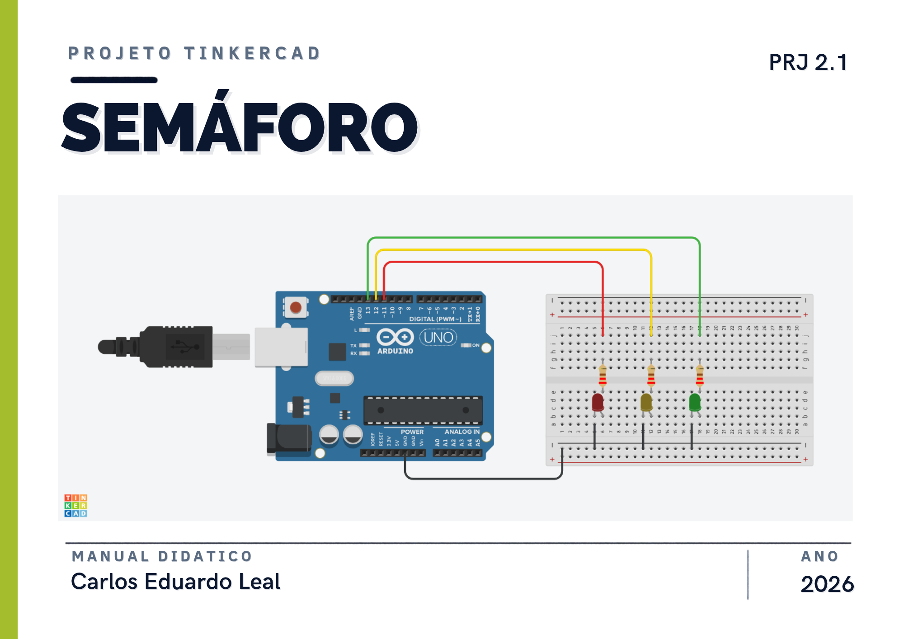

# 🚀 PRJ 2.1 — Semáforo

> **Etapa de Ensino:** Módulo II - Ensino Fundamental I  
> **Nível de Complexidade:** `Básico` | **Tempo Estimado:** `1 h/aula (60 min)`  
> *Manual Didático de Computação — Metodologia e Montagem para Laboratórios Escolares*

---

## 📸 Identidade Visual do Projeto

<div align="center">
  
  <p><em>Figura de Capa: Semáforo (PRJ 2.1)</em></p>
</div>

---

## 📌 Metadados e Plataformas de Simulação

| Parâmetro | Detalhamento |
| :--- | :--- |
| **Identificador** | `PRJ 2.1` |
| **Título do Projeto** | Semáforo |
| **Módulo Curricular** | Módulo II - Ensino Fundamental I |
| **Complexidade Didática** | `Básico` |
| **Duração Estimada** | 1 h/aula (60 min) |

### 🔗 Links para Simulação Online
- 🟦 **Tinkercad Circuits:** [Acessar Modelo no Tinkercad](https://www.tinkercad.com/) *(ou montar cópia virtual do circuito)*
- 🟩 **Wokwi Simulator:** *(Espaço reservado para inclusão do link de simulação no Wokwi)*

---

## 🎯 Objetivos de Aprendizagem e Fundamentação BNCC

**Pré-Requisitos Recomendados:**  
Circuito fechado, polaridade de LEDs, uso de resistores e identificação dos pinos digitais. Reconhecer as cores da sinalização com exemplos do entorno da escola.

### 💡 Habilidades de Pensamento Computacional:
- Variáveis e constantes
- Sequenciamento linear de instruções
- Temporização com delay()
- Controle de saídas digitais

### 🌐 Articulação Interdisciplinar:
- **Historia E Sociedade:** A sinalização organiza o encontro entre pessoas e veículos nas ruas. O uso de luzes permite comunicar regras a muitos usuários ao mesmo tempo. Na escola, uma maquete ajuda a discutir respeito à travessia e mostra como uma sequência automática precisa ser compreendida por todos.
- **Matematica:** Converter milissegundos em segundos, somar os intervalos de um ciclo e comparar a duração das três luzes: 5 s, 5 s e 3 s.

---

## 📖 Contextualização Histórica e Problema Real

Como repetir uma sequência de sinais sem alguém ligar cada luz? O Arduino acende vermelho, verde e amarelo em intervalos definidos no programa. Cada LED representa um estado, e apenas uma cor deve permanecer acesa por vez. O circuito modela a temporização de um semáforo em uma maquete, permitindo discutir o tempo reservado para cada movimento.

---

## 🛠️ Arquitetura de Hardware e Lista de Materiais (BOM)

### 📋 Componentes e Quantitativos:

| Qtd | Componente / Especificação |
| :---: | :--- |
| 1x | Placa Arduino Uno R3 |
| 1x | Cabo USB compatível |
| 1x | LED vermelho |
| 1x | LED amarelo |
| 1x | LED verde |
| 3x | Resistores de 220 Ω, um em série com cada LED |
| 1x | Protoboard, conforme a imagem da montagem |
| 1x | Conjunto de jumpers; quantidade individual não especificada |

### 🔌 Mapeamento de Pinos e Conexões Elétricas:

- D11 → anodo do LED vermelho via resistor de 220 Ω (LED_VERMELHO)
- D12 → anodo do LED amarelo via resistor de 220 Ω (LED_AMARELO)
- D13 → anodo do LED verde via resistor de 220 Ω (LED_VERDE)
- GND → catodos dos três LEDs

### 📐 Diagrama Esquemático do Circuito:

<div align="center">
  
  <p><em>FIGURA 1: ESQUEMA DO CIRCUITO</em></p>
</div>

📄 **Arquivo Esquemático Vetorial para Impressão:** [PRJ 2.1 Esquematico.pdf](./PRJ 2.1 Esquematico.pdf)

---

## 🧠 Modelagem Lógica e Algorítmica

### 🔄 Sequência de Operação e Lógica de Controle:

1. Defição dos Pinos
2. Setup
3. Acender LED vermelho 
4. Delay
5. Desligar LED Vermelho
6. Acender LED verde
7. Delay
8. Deslgiar LED Verde
9. Acender LED Amarelo
10. Delay
11. Desligar LED Amarelo
12. Loop

### 📊 Diagrama de Fluxo Lógico (Fluxograma):

<div align="center">
  
  <p><em>FIGURA 2: FLUXOGRAMA LÓGICO-ALGORÍTMICO DO FIRMWARE</em></p>
</div>

### 💻 Firmware / Código-Fonte em C++ (Arduino IDE):

```cpp
// ==========================
// Pinos Arduino
// ==========================

const int LED_VERMELHO = 11;
const int LED_AMARELO = 12;
const int LED_VERDE = 13;

void setup() {
  // Configura os pinos dos LEDs como saídas digitais
  pinMode(LED_VERMELHO, OUTPUT);
  pinMode(LED_AMARELO, OUTPUT);
  pinMode(LED_VERDE, OUTPUT);
}

void loop() {
  // Estado 1: Vermelho aceso (Pare)
  digitalWrite(LED_VERMELHO, HIGH);
  digitalWrite(LED_AMARELO, LOW);
  digitalWrite(LED_VERDE, LOW);
  delay(5000); // Mantém por 3 segundos

  // Estado 2: Verde aceso (Siga)
  digitalWrite(LED_VERMELHO, LOW);
  digitalWrite(LED_AMARELO, LOW);
  digitalWrite(LED_VERDE, HIGH);
  delay(5000); // Mantém por 3 segundos

  // Estado 3: Amarelo aceso (Atenção)
  digitalWrite(LED_VERMELHO, LOW);
  digitalWrite(LED_AMARELO, HIGH);
  digitalWrite(LED_VERDE, LOW);
  delay(3000); // Mantém por 1 segundo
}
```

📁 **Arquivo fonte compilável:** [`PRJ 2.1 Semaforo.ino`](./PRJ 2.1 Semaforo.ino)

---

## 📝 Roteiro Prático de Execução (Passo a Passo)

1. Com o USB desligado, separe os três LEDs e os resistores de 220 Ω. Confira anodo e catodo antes de inserir as peças na protoboard.
2. Ligue vermelho a D11, amarelo a D12 e verde a D13, sempre por meio de um resistor em série. Esses são os pinos presentes no .ino e na imagem.
3. Conecte os catodos ao GND comum. Confira se cada LED ocupa conexões independentes e se o resistor não foi desviado por um jumper.
4. Abra o .ino original na IDE, selecione Arduino Uno e a porta da placa. Não são necessárias bibliotecas adicionais. O campo CODIGO_FONTE é um recorte didático de até 20 linhas, sobre ciclo das três luzes; para executar, use PRJ 2.1 Semaforo.ino completo (trecho nas linhas 16–34).
5. Carregue o programa e observe a ordem vermelho, verde e amarelo. Cronometre os intervalos de 5, 5 e 3 segundos; alguns comentários do fonte descrevem durações diferentes dos valores executados.
6. Registre a duração total de 13 segundos e explique cada troca de estado. O código original foi preservado, incluindo seus comentários; desligue a placa antes de alterar conexões.

---

## 🔍 Articulação Teórica e Aprofundamento

1) Saídas Digitais: pinMode() prepara os pinos como OUTPUT e digitalWrite() define HIGH ou LOW. No circuito com catodos no GND, o nível alto permite a passagem de corrente pelo resistor e pelo LED correspondente.

2) Resistores e Polaridade: Cada LED recebe seu próprio resistor de 220 Ω para limitar a corrente. Inverter o LED pode impedir seu acendimento, por isso a orientação dos terminais faz parte da conferência da montagem.

3) Tempo Executado: delay() usa milissegundos, e os valores do arquivo são 5000, 5000 e 3000. Os comentários com outros tempos foram mantidos por fidelidade ao fonte, mas a análise do comportamento deve usar os valores reais.

4) Estados e Repetição: O loop organiza os estados vermelho, verde e amarelo e reinicia continuamente. O modelo não possui botão de pedestre nem sensor; essas entradas só passam a existir se forem acrescentadas em uma expansão.

---

## 🌟 Desafios de Expansão Pedagógica

- **Nível Fácil:** Alterar um intervalo e calcular a nova duração total do ciclo antes de testar.
- **Nível Intermediário:** Acrescentar um buzzer para produzir um aviso sonoro.

---

## 📂 Conteúdo do Diretório

| Arquivo | Finalidade |
| :--- | :--- |
| [`PRJ 2.1 Esquema.png`](./PRJ 2.1 Esquema.png) | Esquema elétrico e montagem gráfica do circuito |
| [`PRJ 2.1 Esquematico.pdf`](./PRJ 2.1 Esquematico.pdf) | Documento esquemático / técnico em PDF de alta resolução |
| [`PRJ 2.1 Fluxograma.png`](./PRJ 2.1 Fluxograma.png) | Fluxograma lógico-algorítmico do firmware |
| [`PRJ 2.1 Semaforo.ino`](./PRJ 2.1 Semaforo.ino) | Firmware em código C++ para carregar no Arduino |
| [`PRJ 2.1 Semaforo.json`](./PRJ 2.1 Semaforo.json) | Estrutura JSON de dados e metadados pedagógicos |
| [`Semaforo.png`](./Semaforo.png) | Fotografia / Identidade visual de capa do projeto |

---
*Manual Didático de Computação — Curso de Tecnologia em Sistemas de Computação (UFF)*
