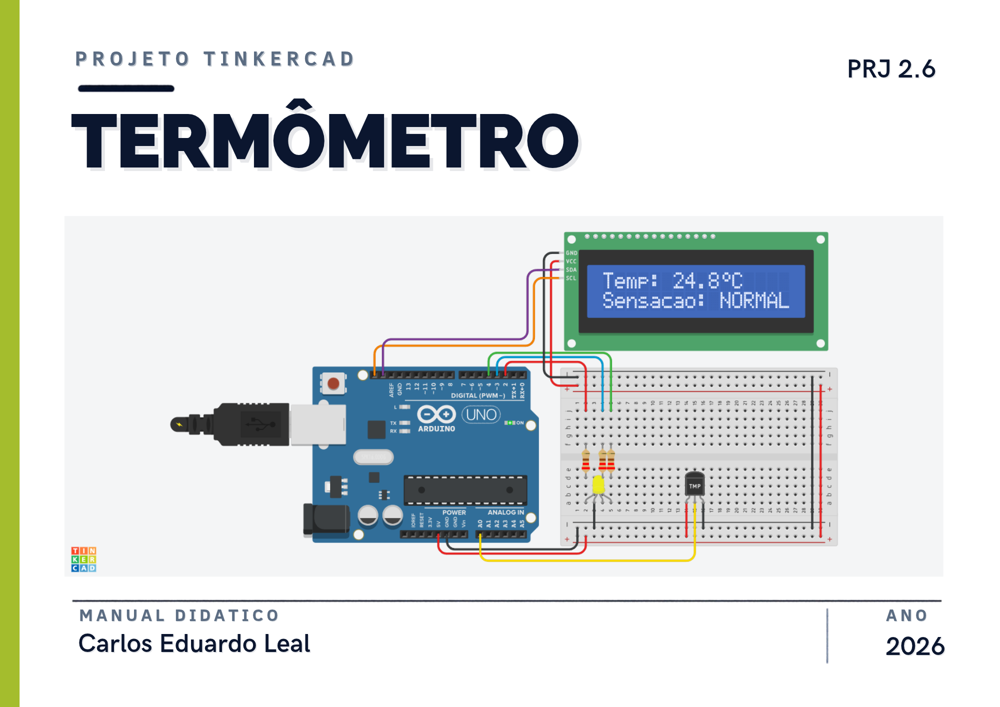

# 🚀 PRJ 2.6 — Termômetro

> **Etapa de Ensino:** Módulo II - Ensino Fundamental I  
> **Nível de Complexidade:** `Intermediário` | **Tempo Estimado:** `2 h/aula (120 min)`  
> *Manual Didático de Computação — Metodologia e Montagem para Laboratórios Escolares*

---

## 📸 Identidade Visual do Projeto

<div align="center">
  
  <p><em>Figura de Capa: Termômetro (PRJ 2.6)</em></p>
</div>

---

## 📌 Metadados e Plataformas de Simulação

| Parâmetro | Detalhamento |
| :--- | :--- |
| **Identificador** | `PRJ 2.6` |
| **Título do Projeto** | Termômetro |
| **Módulo Curricular** | Módulo II - Ensino Fundamental I |
| **Complexidade Didática** | `Intermediário` |
| **Duração Estimada** | 2 h/aula (120 min) |

### 🔗 Links para Simulação Online
- 🟦 **Tinkercad Circuits:** [Acessar Modelo no Tinkercad](https://www.tinkercad.com/) *(ou montar cópia virtual do circuito)*
- 🟩 **Wokwi Simulator:** *(Espaço reservado para inclusão do link de simulação no Wokwi)*

---

## 🎯 Objetivos de Aprendizagem e Fundamentação BNCC

**Pré-Requisitos Recomendados:**  
Leitura de números decimais, comparação de valores e noção de temperatura. Identificar sensor, LED RGB e LCD com auxílio do professor.

### 💡 Habilidades de Pensamento Computacional:
- Leitura analógica
- Conversão de escala
- Decisões encadeadas
- Exibição de dados em texto e cores

### 🌐 Articulação Interdisciplinar:
- **Historia E Sociedade:** Medir a temperatura ajuda a comparar ambientes e perceber mudanças ao longo do dia. Mostradores e cores tornam uma informação numérica mais fácil de acompanhar. Na atividade escolar, as crianças relacionam medidas ao ambiente sem confundir as faixas escolhidas no programa com uma classificação universal de conforto.
- **Matematica:** Ler valores decimais, converter uma leitura de 0 a 1023 em tensão e comparar temperaturas com os limites de 20 °C e 30 °C.

---

## 📖 Contextualização Histórica e Problema Real

Como mostrar uma temperatura de forma numérica e visual? O Arduino lê o TMP36 e converte a tensão em graus Celsius. Abaixo de 20 °C acende azul; de 20 °C a 30 °C combina vermelho e verde para produzir amarelo; acima de 30 °C acende vermelho. O LCD apresenta o valor e a faixa escolhida, criando um indicador ambiental didático.

---

## 🛠️ Arquitetura de Hardware e Lista de Materiais (BOM)

### 📋 Componentes e Quantitativos:

| Qtd | Componente / Especificação |
| :---: | :--- |
| 1x | Placa Arduino Uno R3 |
| 1x | Cabo USB compatível |
| 1x | LCD 16x2 I2C compatível com Adafruit_LiquidCrystal, configurado com deslocamento 0 em relação a 0x20 |
| 1x | Sensor de temperatura TMP36 |
| 1x | LED RGB de catodo comum |
| 3x | Resistores de 220 Ω, um por canal RGB |
| 1x | Protoboard, conforme a imagem da montagem |
| 1x | Conjunto de jumpers; quantidade individual não especificada |

### 🔌 Mapeamento de Pinos e Conexões Elétricas:

- A0 → VOUT do TMP36; +VS → 5V; GND do sensor → GND
- D2 → canal vermelho do RGB via resistor de 220 Ω
- D3 → canal azul do RGB via resistor de 220 Ω
- D4 → canal verde do RGB via resistor de 220 Ω; comum do RGB → GND
- A4/SDA → SDA do módulo I2C; A5/SCL → SCL do módulo I2C (Arduino Uno)
- 5V → VCC dos módulos de 5 V; GND → referência comum, conferindo as ligações da montagem

### 📐 Diagrama Esquemático do Circuito:

<div align="center">
  
  <p><em>FIGURA 1: ESQUEMA DO CIRCUITO</em></p>
</div>

📄 **Arquivo Esquemático Vetorial para Impressão:** [PRJ 2.6 Esquematico.pdf](./PRJ 2.6 Esquematico.pdf)

---

## 🧠 Modelagem Lógica e Algorítmica

### 🔄 Sequência de Operação e Lógica de Controle:

1. Ler TMP36 em A0
2. Converter leitura em tensão
3. Calcular temperatura Celsius
4. Comparar com 20 °C e 30 °C
5. Selecionar azul, amarelo ou vermelho
6. Atualizar LCD e Monitor Serial
7. Aguardar 1000 ms
8. Repetir

### 📊 Diagrama de Fluxo Lógico (Fluxograma):

<div align="center">
  
  <p><em>FIGURA 2: FLUXOGRAMA LÓGICO-ALGORÍTMICO DO FIRMWARE</em></p>
</div>

### 💻 Firmware / Código-Fonte em C++ (Arduino IDE):

```cpp
#include <Wire.h>
#include <Adafruit_LiquidCrystal.h>

// ===== LCD I2C =====
Adafruit_LiquidCrystal lcd(0);

// ===== PINOS =====
const int sensorPin = A0;

const int ledVermelho = 2;
const int ledAzul = 3;
const int ledVerde = 4;

float temperatura = 0;

// ===== SIMBOLO DE GRAU PERSONALIZADO =====
byte simboloGrau[8] = {
  B00110,
  B01001,
  B01001,
  B00110,
  B00000,
  B00000,
  B00000,
  B00000
};

// ===== CONTROLE DO LED RGB =====
void controlarLED(bool vermelho, bool verde, bool azul) {
  digitalWrite(ledVermelho, vermelho ? HIGH : LOW);
  digitalWrite(ledVerde, verde ? HIGH : LOW);
  digitalWrite(ledAzul, azul ? HIGH : LOW);
}

void setup() {

  // Inicializa o Monitor Serial
  Serial.begin(9600);

  // Configuracao dos LEDs
  pinMode(ledVermelho, OUTPUT);
  pinMode(ledVerde, OUTPUT);
  pinMode(ledAzul, OUTPUT);

  controlarLED(false, false, false);

  // ===== INICIALIZACAO DO LCD =====
  lcd.begin(16, 2);
  lcd.setBacklight(HIGH);

  // Cria o simbolo de grau na posicao 0
  lcd.createChar(0, simboloGrau);

  lcd.clear();

  lcd.setCursor(0, 0);
  lcd.print("TERMOMETRO");

  lcd.setCursor(0, 1);
  lcd.print("Iniciando...");

  Serial.println("Sistema iniciado!");

  delay(2000);
  lcd.clear();
}

void loop() {

  // ===== LEITURA DA TEMPERATURA =====
  int leitura = analogRead(sensorPin);

  float tensao = leitura * (5.0 / 1023.0);

  // Conversao para graus Celsius (TMP36)
  temperatura = (tensao - 0.5) * 100.0;

  const char* cor;
  const char* estado;

  // ===== MAQUINA DE ESTADOS =====

  if (temperatura < 20.0) {

    // ESTADO FRIO - LED AZUL
    controlarLED(false, false, true);

    cor = "AZUL";
    estado = "FRIO";

  }
  else if (temperatura <= 30.0) {

    // ESTADO NORMAL - LED AMARELO
    controlarLED(true, true, false);

    cor = "AMARELO";
    estado = "NORMAL";

  }
  else {

    // ESTADO QUENTE - LED VERMELHO
    controlarLED(true, false, false);

    cor = "VERMELHO";
    estado = "QUENTE";
  }

  // ===== MONITOR SERIAL =====
  Serial.print("Temperatura: ");
  Serial.print(temperatura, 1);
  Serial.print(" C | Estado: ");
  Serial.print(estado);
  Serial.print(" | LED: ");
  Serial.println(cor);

  // ===== DISPLAY LCD =====

  // Primeira linha: Temperatura
  lcd.setCursor(0, 0);
  lcd.print("                ");

  lcd.setCursor(0, 0);
  lcd.print("Temp: ");
  lcd.print(temperatura, 1);

  // Exibe o simbolo de grau personalizado
  lcd.write((byte)0);
  lcd.print("C");

  // Segunda linha: Estado
  lcd.setCursor(0, 1);
  lcd.print("                ");

  lcd.setCursor(0, 1);
  lcd.print("Sensacao: ");
  lcd.print(estado);

  // Atualiza a cada 1 segundo
  delay(1000);
}
```

📁 **Arquivo fonte compilável:** [`PRJ 2.6 Termometro.ino`](./PRJ 2.6 Termometro.ino)

---

## 📝 Roteiro Prático de Execução (Passo a Passo)

1. Identifique o TMP36 e confira seus terminais no componente usado, com alimentação desconectada. Não substitua por outro sensor sem revisar a conversão de temperatura.
2. Ligue VOUT a A0 e os terminais de alimentação ao 5V e GND. Monte os três canais do RGB com resistores individuais: vermelho D2, azul D3 e verde D4.
3. Conecte o LCD ao barramento I2C do Uno e à alimentação. Confira o GND comum antes de ligar o USB.
4. Instale Adafruit LiquidCrystal, abra o .ino completo com Wire.h e selecione placa e porta. O trecho no JSON destaca a classificação por faixas e as combinações do RGB. O campo CODIGO_FONTE é um recorte didático de até 20 linhas, sobre classificação por faixa e mistura das cores; para executar, use PRJ 2.6 Termometro.ino completo (trecho nas linhas 84–109).
5. Carregue e leia LCD e Monitor Serial a 9600 baud. Em simulação, varie a temperatura para testar abaixo de 20 °C, exatamente 20 °C, 30 °C e acima de 30 °C.
6. Registre valor e cor em uma tabela. No teste físico, observe apenas mudanças ambientais seguras, sem chama ou aquecimento direto; as faixas não representam medição clínica.

---

## 🔍 Articulação Teórica e Aprofundamento

1) Conversão do TMP36: O programa usa tensão = leitura × 5/1023 e temperatura = (tensão − 0,5) × 100. A expressão depende do sensor TMP36 e da referência adotada, por isso não é uma fórmula genérica para qualquer termômetro.

2) Faixas de Decisão: O primeiro teste usa temperatura menor que 20 e o segundo menor ou igual a 30. Assim, 20 °C e 30 °C pertencem à faixa NORMAL; testar os valores de fronteira ajuda a entender os operadores.

3) Mistura de Cores: O amarelo é produzido ligando os canais vermelho e verde do RGB, e não por um quarto LED. controlarLED() recebe os estados dos canais e reúne as escritas digitais em uma função.

4) Comunicação do Resultado: O LCD recebe o número e a descrição da faixa, e o Monitor Serial repete dados para conferência. O caractere de grau é desenhado em uma matriz de oito linhas; delay(1000) define a atualização aproximada.

---

## 🌟 Desafios de Expansão Pedagógica

- **Nível Fácil:** Registrar temperaturas de dois locais da sala e comparar as cores indicadas.
- **Nível Intermediário:** Modificar os limites das faixas e elaborar uma tabela com os novos valores de fronteira.
- **Nível Avançado:** Usar millis() para atualizar o LCD sem delay() e calcular uma média de poucas leituras, comparando a estabilidade com o programa original.

---

## 📂 Conteúdo do Diretório

| Arquivo | Finalidade |
| :--- | :--- |
| [`PRJ 2.6 Esquema.png`](./PRJ 2.6 Esquema.png) | Esquema elétrico e montagem gráfica do circuito |
| [`PRJ 2.6 Esquematico.pdf`](./PRJ 2.6 Esquematico.pdf) | Documento esquemático / técnico em PDF de alta resolução |
| [`PRJ 2.6 Fluxograma.png`](./PRJ 2.6 Fluxograma.png) | Fluxograma lógico-algorítmico do firmware |
| [`PRJ 2.6 Termometro.ino`](./PRJ 2.6 Termometro.ino) | Firmware em código C++ para carregar no Arduino |
| [`PRJ 2.6 Termometro.json`](./PRJ 2.6 Termometro.json) | Estrutura JSON de dados e metadados pedagógicos |
| [`Termômetro.png`](./Termômetro.png) | Fotografia / Identidade visual de capa do projeto |

---
*Manual Didático de Computação — Curso de Tecnologia em Sistemas de Computação (UFF)*
