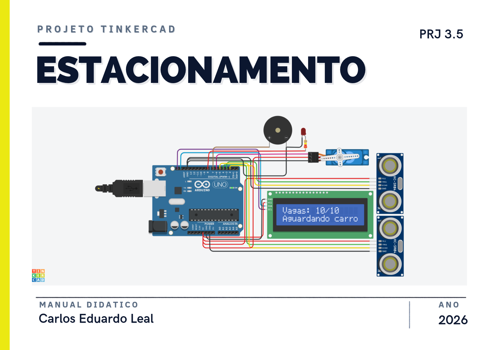

# 🚀 PRJ 3.5 — Estacionamento

> **Etapa de Ensino:** Módulo III - Ensino Fundamental II  
> **Nível de Complexidade:** `Avançado` | **Tempo Estimado:** `3 h/aula (180 min)`  
> *Manual Didático de Computação — Metodologia e Montagem para Laboratórios Escolares*

---

## 📸 Identidade Visual do Projeto

<div align="center">
  
  <p><em>Figura de Capa: Estacionamento (PRJ 3.5)</em></p>
</div>

---

## 📌 Metadados e Plataformas de Simulação

| Parâmetro | Detalhamento |
| :--- | :--- |
| **Identificador** | `PRJ 3.5` |
| **Título do Projeto** | Estacionamento |
| **Módulo Curricular** | Módulo III - Ensino Fundamental II |
| **Complexidade Didática** | `Avançado` |
| **Duração Estimada** | 3 h/aula (180 min) |

### 🔗 Links para Simulação Online
- 🟦 **Tinkercad Circuits:** [Acessar Modelo no Tinkercad](https://www.tinkercad.com/) *(ou montar cópia virtual do circuito)*
- 🟩 **Wokwi Simulator:** *(Espaço reservado para inclusão do link de simulação no Wokwi)*

---

## 🎯 Objetivos de Aprendizagem e Fundamentação BNCC

**Pré-Requisitos Recomendados:**  
Máquina de estados, vetores, ultrassom, servo e LCD I2C. Relacionar sequência de passagem, ocupação e capacidade de um espaço.

### 💡 Habilidades de Pensamento Computacional:
- Contagem com limites
- Validação de leituras consecutivas
- Controle por máquina de estados
- Temporização de sinalização e liberação

### 🌐 Articulação Interdisciplinar:
- **Historia E Sociedade:** Estacionamentos precisam informar vagas e organizar a passagem de veículos. Uma contagem correta depende de distinguir quem entrou de quem saiu. A maquete permite discutir como sensores, mensagens e avisos ajudam na operação, além de mostrar que uma leitura isolada pode ser insuficiente para confirmar uma passagem.
- **Matematica:** Calcular vagas livres como 10 menos ocupadas, interpretar limites de 100 e 115 cm e comparar prazos de 1 s e 8 s para liberação da cancela.

---

## 📖 Contextualização Histórica e Problema Real

Como abrir uma cancela e atualizar vagas somente depois de uma passagem confirmada? Dois sensores registram a ordem de chegada: S1–S2 confirma entrada, e S2–S1 confirma saída. O programa limita a capacidade a dez vagas e impede nova entrada quando a lotação é atingida. LED e buzzer indicam a cancela aberta, enquanto o LCD mostra vagas e mensagens do estado atual.

---

## 🛠️ Arquitetura de Hardware e Lista de Materiais (BOM)

### 📋 Componentes e Quantitativos:

| Qtd | Componente / Especificação |
| :---: | :--- |
| 1x | Placa Arduino Uno R3 |
| 1x | Cabo USB compatível |
| 1x | LCD 16x2 I2C compatível com Adafruit_LiquidCrystal, configurado com deslocamento 0 em relação a 0x20 |
| 2x | Sensores HC-SR04 |
| 1x | Microservo |
| 1x | Piezo/buzzer |
| 1x | LED vermelho |
| 1x | Resistor de 220 kΩ indicado como R1 no PDF; valor deve ser conferido antes da montagem física |
| 1x | Conjunto de jumpers; quantidade não especificada |

### 🔌 Mapeamento de Pinos e Conexões Elétricas:

- S1: D3 → TRIG; D2 → ECHO
- S2: D4 → TRIG; D5 → ECHO
- D6 → sinal do servo da cancela
- D7 → piezo/buzzer; D8 → LED vermelho via resistor
- Resistor do LED: PDF indica 220 kΩ; conferir valor e corrente no circuito físico
- A4/SDA → SDA do módulo I2C; A5/SCL → SCL do módulo I2C (Arduino Uno)
- 5V → VCC dos módulos de 5 V; GND → referência comum, conferindo as ligações da montagem

### 📐 Diagrama Esquemático do Circuito:

<div align="center">
  
  <p><em>FIGURA 1: ESQUEMA DO CIRCUITO</em></p>
</div>

📄 **Arquivo Esquemático Vetorial para Impressão:** [PRJ 3.5 Esquematico.pdf](./PRJ 3.5 Esquematico.pdf)

---

## 🧠 Modelagem Lógica e Algorítmica

### 🔄 Sequência de Operação e Lógica de Controle:

1. Inicializar capacidade de 10 vagas
2. Alternar sensores a cada 65 ms
3. Confirmar duas leituras próximas
4. Identificar direção pelo primeiro sensor
5. Abrir ou informar lotação
6. Confirmar passagem no segundo sensor
7. Atualizar vagas
8. Aguardar ambos livres e fechar
9. Atualizar avisos sem delay no ciclo principal

### 📊 Diagrama de Fluxo (Fluxograma):

*(Fluxograma em processo de elaboração gráfica — a modelagem lógica completa está descrita no fluxo passo a passo acima).*

### 💻 Firmware / Código-Fonte em C++ (Arduino IDE):

```cpp
#include <Wire.h>
#include <Adafruit_LiquidCrystal.h>
#include <Servo.h>

Adafruit_LiquidCrystal lcd(0);
Servo cancela;
const byte TRIG[] = {3, 4};
const byte ECHO[] = {2, 5};
const byte SERVO = 6, BUZZER = 7, LED = 8;
const byte CAPACIDADE = 10;
const byte FECHADA = 0, ABERTA = 90;
const int DETECTAR_CM = 100, LIBERAR_CM = 115;
const unsigned long INTERVALO_MS = 65;
const unsigned long TEMPO_DESISTENCIA_MS = 8000;
const unsigned long TEMPO_LIBERACAO_MS = 1000;

enum Estado { PRONTO, ENTRANDO, SAINDO, CONFIRMADO, LOTADO };
Estado estado = PRONTO;
byte ocupadas = 0;
bool presente[2] = {};
bool livre[2] = {};
byte pertoSeguido[2] = {};
byte longeSeguido[2] = {};
byte sensor = 0;
unsigned long ultimoDisparo = 0, inicioLivre = 0;
bool contandoTempoLivre = false;

void mostrar(const char* mensagem) {
  lcd.clear();
  lcd.print("Vagas: ");
  lcd.print(CAPACIDADE - ocupadas);
  lcd.print("/");
  lcd.print(CAPACIDADE);
  lcd.setCursor(0, 1);
  lcd.print(mensagem);
}
// Retorna true apenas quando um carro acaba de chegar ao sensor.
bool detectarChegada(byte i) {
  digitalWrite(TRIG[i], LOW);
  delayMicroseconds(2);
  digitalWrite(TRIG[i], HIGH);
  delayMicroseconds(10);
  digitalWrite(TRIG[i], LOW);
  unsigned long eco = pulseIn(ECHO[i], HIGH, 25000UL);
  float cm = eco * 0.0343f / 2;
  bool perto = eco > 0 && cm >= 2 && cm < DETECTAR_CM;
  bool longe = cm >= LIBERAR_CM && cm <= 400;
  if (!perto) pertoSeguido[i] = 0;
  else if (pertoSeguido[i] < 2) ++pertoSeguido[i];
  if (!longe) longeSeguido[i] = 0;
  else if (longeSeguido[i] < 2) ++longeSeguido[i];
  livre[i] = longeSeguido[i] == 2;
  if (livre[i]) presente[i] = false;
  if (!presente[i] && pertoSeguido[i] == 2) {
    presente[i] = true;
    return true;
  }
  return false;
}

void registrar(byte i) {
  if (estado == PRONTO) {
    if (i == 0 && ocupadas == CAPACIDADE) {
      estado = LOTADO;
      mostrar("Lotado");
      return;
    }
    estado = i == 0 ? ENTRANDO : SAINDO;
    cancela.write(ABERTA);
    mostrar(i == 0 ? "Aguardando S2" : "Aguardando S1");
  } else if (estado == ENTRANDO && i == 1) {
    ++ocupadas;
    estado = CONFIRMADO;
    mostrar("Carro entrou");
  } else if (estado == SAINDO && i == 0) {
    if (ocupadas > 0) --ocupadas;
    estado = CONFIRMADO;
    mostrar("Carro saiu");
  }
}

void verificarLiberacao(unsigned long agora) {
  if (estado == PRONTO || !livre[0] || !livre[1]) {
    contandoTempoLivre = false;
    return;
  }
  if (!contandoTempoLivre) {
    inicioLivre = agora;
    contandoTempoLivre = true;
  }
  bool aguardando = estado == ENTRANDO || estado == SAINDO;
  unsigned long espera = aguardando ? TEMPO_DESISTENCIA_MS : TEMPO_LIBERACAO_MS;
  if (agora - inicioLivre >= espera) {
    cancela.write(FECHADA);
    estado = PRONTO;
    contandoTempoLivre = false;
    mostrar(ocupadas == CAPACIDADE ? "Lotado" : "Aguardando carro");
  }
}

void atualizarAlerta(unsigned long agora) {
  static bool ligado = false;
  bool aberto = estado == ENTRANDO || estado == SAINDO || estado == CONFIRMADO;
  bool pulso = aberto && (agora / 150UL) % 2 == 0;
  if (pulso == ligado) return;
  ligado = pulso;
  digitalWrite(LED, ligado ? HIGH : LOW);
  if (ligado) tone(BUZZER, 1200);
  else noTone(BUZZER);
}

void setup() {
  for (byte i = 0; i < 2; ++i) {
    pinMode(TRIG[i], OUTPUT);
    pinMode(ECHO[i], INPUT);
    digitalWrite(TRIG[i], LOW);
  }
  pinMode(LED, OUTPUT);
  pinMode(BUZZER, OUTPUT);
  cancela.attach(SERVO);
  cancela.write(FECHADA);
  Wire.begin();
  Serial.begin(9600);
  Wire.beginTransmission(0x20);
  if (Wire.endTransmission() == 0) {
    Serial.println("LCD: resposta I2C em 0x20");
  } else {
    Serial.println("LCD: sem resposta I2C em 0x20");
  }
  lcd.begin(16, 2);
  lcd.setBacklight(HIGH);
  mostrar("Aguardando carro");
}

void loop() {
  unsigned long agora = millis();
  if (agora - ultimoDisparo >= INTERVALO_MS) {
    ultimoDisparo = agora;
    if (detectarChegada(sensor)) registrar(sensor);
    sensor = 1 - sensor;
    verificarLiberacao(millis());
  }
  atualizarAlerta(millis());
}
```

📁 **Arquivo fonte compilável:** [`PRJ 3.5 Estacionamento.ino.ino`](./PRJ 3.5 Estacionamento.ino.ino)

---

## 📝 Roteiro Prático de Execução (Passo a Passo)

1. Monte uma passagem de maquete com S1 e S2 identificados. Fixe o servo a uma cancela leve, com alimentação desligada durante as conexões.
2. Ligue TRIG/ECHO de S1 a D3/D2 e de S2 a D4/D5. Ligue sinal do servo em D6, buzzer em D7 e LED por resistor em D8.
3. Confira o resistor do LED: o PDF indica 220 kΩ, valor que pode produzir brilho muito baixo. Registre a divergência a revisar; não apresente uma troca de valor como parte do esquema original.
4. Conecte LCD I2C e alimentação com GND comum. Instale Adafruit LiquidCrystal e use Servo.h; abra o arquivo .ino.ino completo, que mantém essa extensão duplicada na pasta. O campo CODIGO_FONTE é um recorte didático de até 20 linhas, sobre aviso temporizado sem bloquear a passagem; para executar, use PRJ 3.5 Estacionamento.ino.ino completo (trecho nas linhas 101–110).
5. Carregue e teste S1 seguido de S2 e depois a ordem inversa, confirmando a atualização de vagas. A detecção exige duas leituras próximas; para liberar, ambos precisam registrar distância de pelo menos 115 cm dentro da faixa válida.
6. Simule dez entradas, tentativa com lotação, saída com total zero e passagem abandonada. Observe fechamento após 1 s com via livre em evento confirmado ou 8 s de via livre em espera incompleta. Não há fluxograma fornecido; ARQUIVO permanece vazio.

---

## 🔍 Articulação Teórica e Aprofundamento

1) Confirmação de Presença: Duas leituras consecutivas abaixo de 100 cm confirmam a chegada. Para reconhecer via livre, são exigidas duas leituras entre 115 e 400 cm; ausência de eco não é tratada automaticamente como espaço livre.

2) Direção e Capacidade: A ordem dos sensores escolhe ENTRANDO ou SAINDO. A contagem só muda com o segundo evento e permanece entre zero e dez; a condição LOTADO bloqueia uma nova entrada quando não há vaga.

3) Liberação e Aviso: O fechamento depende de ambos os sensores livres por um prazo. millis() também alterna LED e buzzer em pulsos de 150 ms, permitindo sinalizar enquanto a lógica continua monitorando a passagem.

4) Conferência do Protótipo: O PDF indica resistor de 220 kΩ para o LED e o LCD usa a biblioteca Adafruit. Os totais ficam na RAM e somem no reinício; este modelo não identifica placas, pessoas nem veículos individualmente.

---

## 🌟 Desafios de Expansão Pedagógica

- **Nível Fácil:** Criar uma tabela com entradas, saídas, ocupadas e vagas livres após cada passagem.
- **Nível Intermediário:** Alterar CAPACIDADE para três em uma cópia do fonte e testar lotação e desistência com poucos eventos.
- **Nível Avançado:** Registrar pela serial cada mudança de estado e sua duração, verificando falsas passagens sem adicionar novos componentes.

---

## 📂 Conteúdo do Diretório

| Arquivo | Finalidade |
| :--- | :--- |
| [`Estacionamento.png`](./Estacionamento.png) | Fotografia / Identidade visual de capa do projeto |
| [`PRJ 3.5 Esquema.png`](./PRJ 3.5 Esquema.png) | Esquema elétrico e montagem gráfica do circuito |
| [`PRJ 3.5 Esquematico.pdf`](./PRJ 3.5 Esquematico.pdf) | Documento esquemático / técnico em PDF de alta resolução |
| [`PRJ 3.5 Estacionamento.ino.ino`](./PRJ 3.5 Estacionamento.ino.ino) | Firmware em código C++ para carregar no Arduino |
| [`PRJ 3.5 Estacionamento.json`](./PRJ 3.5 Estacionamento.json) | Estrutura JSON de dados e metadados pedagógicos |

---
*Manual Didático de Computação — Curso de Tecnologia em Sistemas de Computação (UFF)*
