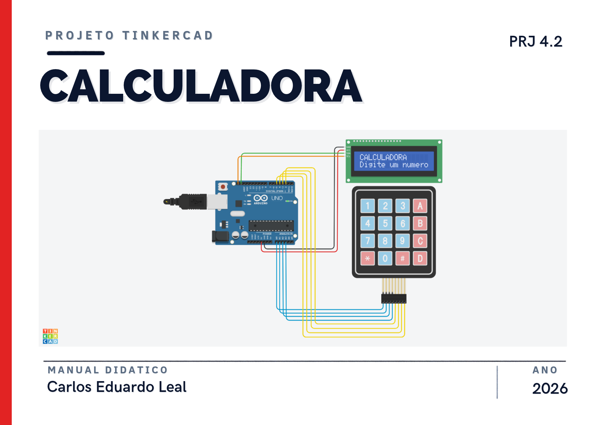

# 🚀 PRJ 4.2 — Calculadora

> **Etapa de Ensino:** Módulo IV - Ensino Médio  
> **Nível de Complexidade:** `Intermediário` | **Tempo Estimado:** `2 h/aula (120 min)`  
> *Manual Didático de Computação — Metodologia e Montagem para Laboratórios Escolares*

---

## 📸 Identidade Visual do Projeto

<div align="center">
  
  <p><em>Figura de Capa: Calculadora (PRJ 4.2)</em></p>
</div>

---

## 📌 Metadados e Plataformas de Simulação

| Parâmetro | Detalhamento |
| :--- | :--- |
| **Identificador** | `PRJ 4.2` |
| **Título do Projeto** | Calculadora |
| **Módulo Curricular** | Módulo IV - Ensino Médio |
| **Complexidade Didática** | `Intermediário` |
| **Duração Estimada** | 2 h/aula (120 min) |

### 🔗 Links para Simulação Online
- 🟦 **Tinkercad Circuits:** [Acessar Modelo no Tinkercad](https://www.tinkercad.com/) *(ou montar cópia virtual do circuito)*
- 🟩 **Wokwi Simulator:** *(Espaço reservado para inclusão do link de simulação no Wokwi)*

---

## 🎯 Objetivos de Aprendizagem e Fundamentação BNCC

**Pré-Requisitos Recomendados:**  
Vetores bidimensionais, varredura de teclado, funções, tipos numéricos e condições. Relacionar a entrada de caracteres à conversão para operações aritméticas.

### 💡 Habilidades de Pensamento Computacional:
- Varredura de matriz 4x4
- Construção e conversão de strings
- Seleção de operação com switch
- Validação de entrada e tratamento de erro

### 🌐 Articulação Interdisciplinar:
- **Historia E Sociedade:** Calculadoras tornam operações repetitivas mais rápidas, mas sua interface precisa deixar claro o que foi digitado. Um resultado só tem sentido quando a operação e os dados estão corretos. Construir esse dispositivo ajuda a discutir a diferença entre executar uma conta, validar a entrada e comunicar uma situação que não pode ser calculada.
- **Matematica:** Quatro operações, divisão por zero, casas decimais e limites de representação. Comparar o resultado exibido com cálculo manual e discutir arredondamento em ponto flutuante.

---

## 📖 Contextualização Histórica e Problema Real

Como transformar teclas em uma operação mostrada no LCD? O teclado matricial informa dígitos e comandos, e o programa monta dois operandos como strings. A, B, C e D selecionam soma, subtração, multiplicação e divisão; # calcula e * limpa. A rotina verifica dados ausentes e divisão por zero antes de apresentar o resultado com duas casas decimais.

---

## 🛠️ Arquitetura de Hardware e Lista de Materiais (BOM)

### 📋 Componentes e Quantitativos:

| Qtd | Componente / Especificação |
| :---: | :--- |
| 1x | Placa Arduino Uno R3 |
| 1x | Cabo USB compatível |
| 1x | LCD 16x2 I2C compatível com Adafruit_LiquidCrystal, configurado com deslocamento 0 em relação a 0x20 |
| 1x | Teclado matricial 4x4 |
| 1x | Conjunto de jumpers; quantidade não especificada |

### 🔌 Mapeamento de Pinos e Conexões Elétricas:

- A0, A1, A2, A3 → linhas 1, 2, 3, 4 do teclado, respectivamente
- D2, D3, D4, D5 → colunas 1, 2, 3, 4 do teclado, INPUT_PULLUP
- A4/SDA → SDA do módulo I2C; A5/SCL → SCL do módulo I2C (Arduino Uno)
- 5V → VCC dos módulos de 5 V; GND → referência comum, conferindo as ligações da montagem

### 📐 Diagrama Esquemático do Circuito:

<div align="center">
  
  <p><em>FIGURA 1: ESQUEMA DO CIRCUITO</em></p>
</div>

📄 **Arquivo Esquemático Vetorial para Impressão:** [PRJ 4.2 Esquematico.pdf](./PRJ 4.2 Esquematico.pdf)

---

## 🧠 Modelagem Lógica e Algorítmica

### 🔄 Sequência de Operação e Lógica de Controle:

1. Varrer linhas e colunas
2. Confirmar tecla e aguardar soltura
3. Acumular primeiro operando
4. Selecionar operação A/B/C/D
5. Acumular segundo operando
6. Receber # para calcular
7. Validar dados e divisor
8. Executar switch e exibir
9. Receber * para limpar

### 📊 Diagrama de Fluxo (Fluxograma):

*(Fluxograma em processo de elaboração gráfica — a modelagem lógica completa está descrita no fluxo passo a passo acima).*

### 💻 Firmware / Código-Fonte em C++ (Arduino IDE):

```cpp
#include <Wire.h>
#include <Adafruit_LiquidCrystal.h>

// =======================================
// CONFIGURACAO DO LCD
// =======================================

Adafruit_LiquidCrystal lcd(0);

// =======================================
// CONFIGURACAO DO TECLADO 4X4
// =======================================

const byte linhas[4] = {A0, A1, A2, A3};
const byte colunas[4] = {2, 3, 4, 5};

char teclas[4][4] = {
  {'1', '2', '3', 'A'},
  {'4', '5', '6', 'B'},
  {'7', '8', '9', 'C'},
  {'*', '0', '#', 'D'}
};

// =======================================
// VARIAVEIS DA CALCULADORA
// =======================================

String numero1 = "";
String numero2 = "";

char operacao = '\0';

bool resultadoPronto = false;

// =======================================
// INICIALIZACAO
// =======================================

void setup() {

  // Inicializa o LCD
  lcd.begin(16, 2);
  lcd.setBacklight(1);
  lcd.clear();

  // Configura as linhas como saidas
  for (int i = 0; i < 4; i++) {
    pinMode(linhas[i], OUTPUT);
    digitalWrite(linhas[i], HIGH);
  }

  // Configura colunas como entradas
  for (int i = 0; i < 4; i++) {
    pinMode(colunas[i], INPUT_PULLUP);
  }

  limparCalculadora();
}

// =======================================
// FUNCAO PARA LER O TECLADO
// =======================================

char lerTeclado() {

  for (int i = 0; i < 4; i++) {

    digitalWrite(linhas[i], LOW);
    delayMicroseconds(10);

    for (int j = 0; j < 4; j++) {

      if (digitalRead(colunas[j]) == LOW) {
        digitalWrite(linhas[i], HIGH);
        return teclas[i][j];
      }
    }

    digitalWrite(linhas[i], HIGH);
  }

  return '\0';
}

// =======================================
// LIMPAR CALCULADORA
// =======================================

void limparCalculadora() {

  numero1 = "";
  numero2 = "";
  operacao = '\0';
  resultadoPronto = false;

  lcd.clear();

  lcd.setCursor(0, 0);
  lcd.print("CALCULADORA");

  lcd.setCursor(0, 1);
  lcd.print("Digite um numero");
}

// =======================================
// ATUALIZAR LCD
// =======================================

void atualizarLCD() {

  lcd.clear();

  lcd.setCursor(0, 0);
  lcd.print(numero1);

  if (operacao != '\0') {
    lcd.print(operacao);
    lcd.print(numero2);
  }

  lcd.setCursor(0, 1);
  lcd.print("A+ B- C* D/");
}

// =======================================
// CALCULAR RESULTADO
// =======================================

void calcular() {

  // Verifica se existem dados suficientes
  if (numero1.length() == 0 ||
      numero2.length() == 0 ||
      operacao == '\0') {

    lcd.clear();
    lcd.setCursor(0, 0);
    lcd.print("Dados invalidos");
    delay(1000);
    atualizarLCD();
    return;
  }

  float a = numero1.toFloat();
  float b = numero2.toFloat();
  float resultado = 0;

  // Verifica divisao por zero
  if (operacao == '/' && b == 0) {

    lcd.clear();

    lcd.setCursor(0, 0);
    lcd.print("ERRO");

    lcd.setCursor(0, 1);
    lcd.print("Divisao por zero");

    resultadoPronto = true;
    return;
  }

  // Seleciona a operacao matematica
  switch (operacao) {

    case '+':
      resultado = a + b;
      break;

    case '-':
      resultado = a - b;
      break;

    case '*':
      resultado = a * b;
      break;

    case '/':
      resultado = a / b;
      break;
  }

  // Mostra a operacao e o resultado
  lcd.clear();

  lcd.setCursor(0, 0);
  lcd.print(numero1);
  lcd.print(operacao);
  lcd.print(numero2);

  lcd.setCursor(0, 1);
  lcd.print("= ");
  lcd.print(resultado, 2);

  resultadoPronto = true;
}

// =======================================
// LOOP PRINCIPAL
// =======================================

void loop() {

  // Ler tecla pressionada
  char tecla = lerTeclado();

  // Nenhuma tecla pressionada
  if (tecla == '\0') {
    return;
  }

  // Eliminar ruido do botao
  delay(30);

  if (lerTeclado() != tecla) {
    return;
  }

  // Esperar soltar o botao
  while (lerTeclado() != '\0') {
    delay(10);
  }

  delay(30);

  // =====================================
  // TECLA * : LIMPAR
  // =====================================

  if (tecla == '*') {
    limparCalculadora();
    return;
  }

  // =====================================
  // TECLAS NUMERICAS
  // =====================================

  if (tecla >= '0' && tecla <= '9') {

    // Comecar novo calculo
    if (resultadoPronto) {
      numero1 = "";
      numero2 = "";
      operacao = '\0';
      resultadoPronto = false;
    }

    // Primeiro numero
    if (operacao == '\0') {

      if (numero1.length() < 7) {
        numero1 += tecla;
      }

    } else {

      // Segundo numero
      if (numero2.length() < 7) {
        numero2 += tecla;
      }
    }

    atualizarLCD();
    return;
  }

  // =====================================
  // TECLAS DAS OPERACOES
  // =====================================

  if (tecla == 'A' ||
      tecla == 'B' ||
      tecla == 'C' ||
      tecla == 'D') {

    // Precisa existir primeiro numero
    if (numero1.length() == 0 ||
        numero2.length() > 0 ||
        resultadoPronto) {
      return;
    }

    if (tecla == 'A') {
      operacao = '+';
    }

    if (tecla == 'B') {
      operacao = '-';
    }

    if (tecla == 'C') {
      operacao = '*';
    }

    if (tecla == 'D') {
      operacao = '/';
    }

    atualizarLCD();
    return;
  }

  // =====================================
  // TECLA # : CALCULAR
  // =====================================

  if (tecla == '#') {

    if (!resultadoPronto) {
      calcular();
    }

    return;
  }
}
```

📁 **Arquivo fonte compilável:** [`PRJ 4.2 Calculadora.ino`](./PRJ 4.2 Calculadora.ino)

---

## 📝 Roteiro Prático de Execução (Passo a Passo)

1. Com USB desligado, identifique a ordem dos oito terminais do teclado. Confira linhas e colunas no modelo usado, pois a ordem física do conector precisa corresponder ao esquema.
2. Conecte linhas a A0–A3 e colunas a D2–D5. O programa faz a varredura diretamente e usa INPUT_PULLUP nas colunas, sem biblioteca de teclado.
3. Conecte LCD a SDA/SCL do Uno, 5V e GND. Instale Adafruit LiquidCrystal e abra o .ino completo; o trecho do JSON destaca a proteção contra divisão por zero.
4. Carregue e teste cada dígito. Digite 12, pressione A, digite 3 e pressione #; verifique resultado 15,00, conforme o formato decimal do LCD. O campo CODIGO_FONTE é um recorte didático de até 20 linhas, sobre proteção contra divisão por zero; para executar, use PRJ 4.2 Calculadora.ino completo (trecho nas linhas 149–161).
5. Repita com B, C e D. Teste # sem operandos completos, divisão por zero e * para limpar; o programa aceita até sete dígitos em cada operando e não possui tecla decimal.
6. Compare contas simples com valores grandes e registre a precisão observada. Após um resultado, digitar um número inicia outra operação; não há cadeia automática de cálculos implementada. Não há fluxograma fornecido; ARQUIVO permanece vazio.

---

## 🔍 Articulação Teórica e Aprofundamento

1) Varredura Matricial: Uma linha é levada a LOW por vez, e as colunas são lidas com pull-up interno. A combinação linha/coluna seleciona um caractere em teclas[4][4], reduzindo o número de fios necessário para dezesseis comandos.

2) Entrada e Conversão: Os operandos são acumulados como String e convertidos por toFloat(). O limite de sete dígitos reduz o tamanho digitado, mas não garante precisão decimal exata; a interface não inclui entrada de ponto decimal.

3) Operações e Erros: switch seleciona a operação, enquanto uma condição anterior impede dividir por zero. O teste de operandos vazios evita apresentar um resultado que não corresponde a uma entrada completa.

4) Estado da Interface: resultadoPronto diferencia uma conta em edição de uma saída já calculada. O LCD de duas linhas exige mensagens curtas, e o debounce com espera pela soltura impede que uma tecla seja repetida pelo mesmo acionamento.

---

## 🌟 Desafios de Expansão Pedagógica

- **Nível Fácil:** Montar uma tabela de testes com uma operação de cada tipo e conferir os resultados manualmente.
- **Nível Intermediário:** Melhorar as mensagens de entrada incompleta e testar contas negativas e resultados com casas decimais.
- **Nível Avançado:** Substituir strings dinâmicas por buffers limitados e tratar estouro de entrada, preservando teclado e LCD em uma versão separada.

---

## 📂 Conteúdo do Diretório

| Arquivo | Finalidade |
| :--- | :--- |
| [`Calculadora.png`](./Calculadora.png) | Fotografia / Identidade visual de capa do projeto |
| [`PRJ 4.2 Calculadora.ino`](./PRJ 4.2 Calculadora.ino) | Firmware em código C++ para carregar no Arduino |
| [`PRJ 4.2 Calculadora.json`](./PRJ 4.2 Calculadora.json) | Estrutura JSON de dados e metadados pedagógicos |
| [`PRJ 4.2 Esquema.png`](./PRJ 4.2 Esquema.png) | Esquema elétrico e montagem gráfica do circuito |
| [`PRJ 4.2 Esquematico.pdf`](./PRJ 4.2 Esquematico.pdf) | Documento esquemático / técnico em PDF de alta resolução |

---
*Manual Didático de Computação — Curso de Tecnologia em Sistemas de Computação (UFF)*
