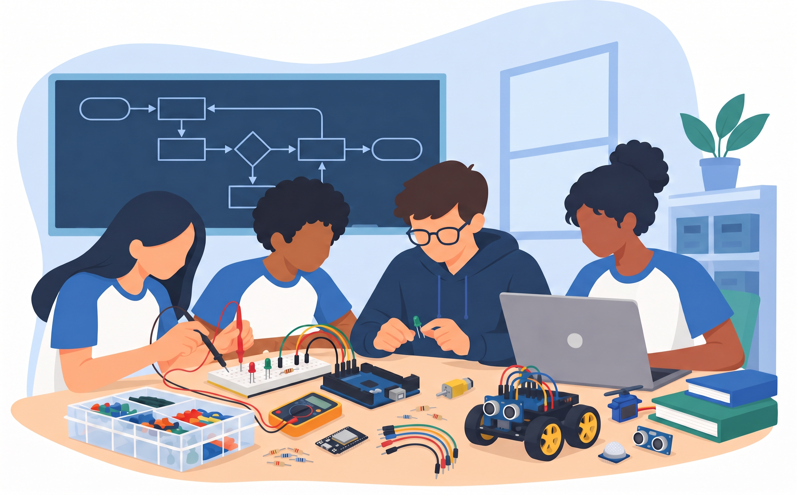
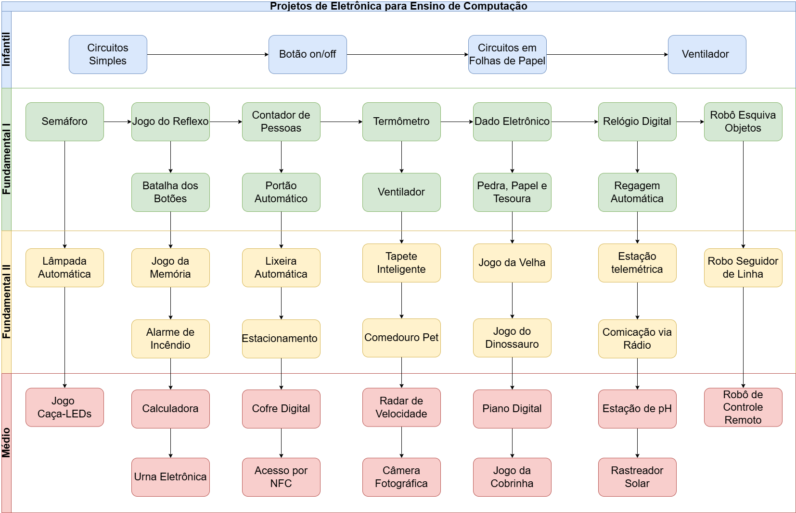
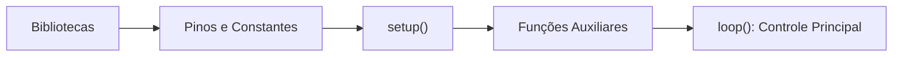
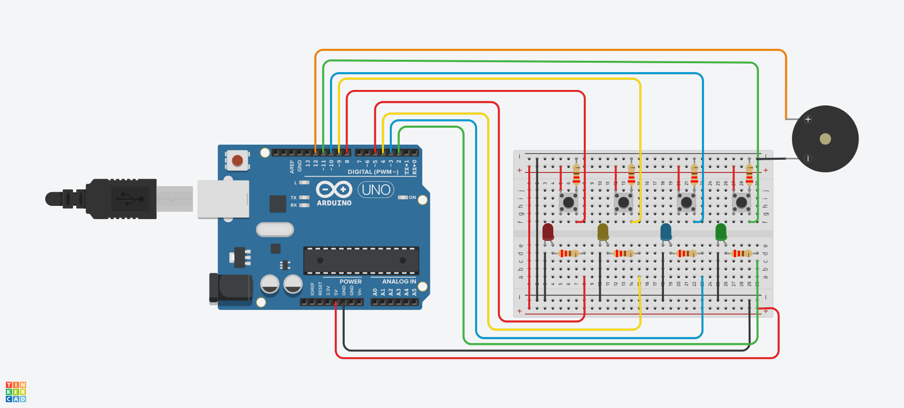
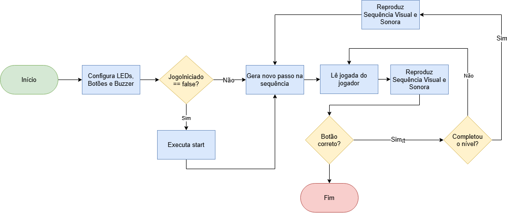

# 📚 Manual Didático de Computação: Metodologia e Montagem para Laboratórios Escolares

<div align="center">



<p align="center">
  <strong>Guia Prático, Modular e Interdisciplinar para o Ensino de Ciência da Computação e Sistemas Embarcados na Educação Básica</strong>
</p>

[](LICENSE)
[](#marco-regulatório-e-fundamentação)
[](#arquitetura-e-ecossistema-de-ferramentas)
[](#arquitetura-e-ecossistema-de-ferramentas)
[](#)
[](https://manual-didatico-computacao.vercel.app/)

</div>

---

## 🌐 Acesso Online (Vercel)

O manual completo e iterativo está hospedado e pode ser acessado diretamente pelo navegador sem a necessidade de baixar os arquivos HTML:

👉 **[Acessar o Manual Completo Online](https://manual-didatico-computacao.vercel.app/)**

---

## 📖 Visão Geral e Contexto

A trajetória da inclusão das Tecnologias de Informação e Comunicação (TIC) nas escolas brasileiras frequentemente priorizou a aquisição de equipamentos em detrimento da apropriação científica da Computação. O modelo predominante manteve o computador como uma ferramenta instrumental (digitação, pesquisas e softwares educativos fechados), tratando a tecnologia como uma **"caixa-preta"**.

Este manual rompe com essa visão tecnicista. Alinhado às diretrizes da **Base Nacional Comum Curricular (BNCC)** e à **Resolução CNE/CEB nº 1/2022**, o projeto propõe o desenvolvimento do **Pensamento Computacional** e da computação física como instrumentos de emancipação e autoria tecnológica.

### 🏛️ Pilares Epistemológicos e Metodológicos

* **Seymour Papert (Construcionismo):** A aprendizagem de conceitos abstratos de lógica e algoritmos atinge seu ápice quando mediada pela criação tangível de artefatos no mundo físico (sensores, circuitos, robôs e atuadores).
* **Paulo Freire (Pedagogia da Autonomia):** Superação da passividade do aluno consumidor para a formação de sujeitos conscientes, capazes de questionar, projetar e transformar sua realidade sócio-tecnológica.
* **Viabilidade Pública e Acesso Universal:** Priorização de plataformas de código aberto (*Open Source*), ferramentas gratuitas na nuvem (Tinkercad, Wokwi) e componentes de baixo custo para permitir a implementação em larga escala em redes públicas de ensino.

---

## 🗺️ Fluxograma Panorâmico de Progressão Pedagógica

A sequência didática organiza-se de forma progressiva e contínua em **4 Módulos Curriculares**, respeitando as fases de maturação cognitiva desde a Educação Infantil até o Ensino Médio:

<div align="center">
  
</div>

<br>

<table width="100%">
  <thead>
    <tr style="background-color: #0f172a; color: #ffffff;">
      <th align="center" width="12%">Módulo</th>
      <th align="left" width="28%">Etapa de Ensino</th>
      <th align="left" width="40%">Foco Didático e Competências</th>
      <th align="center" width="20%">Abordagem Tecnológica</th>
    </tr>
  </thead>
  <tbody>
    <tr>
      <td align="center"><strong>MÓD. I</strong></td>
      <td><strong>Educação Infantil</strong></td>
      <td>Percepção espacial, decomposição lúdica, reconhecimento de padrões e circuitos básicos de condutividade.</td>
      <td><span style="background:#dcfce7;color:#166534;padding:2px 8px;border-radius:4px;font-size:12px;font-weight:bold;">Computação Desplugada</span></td>
    </tr>
    <tr>
      <td align="center"><strong>MÓD. II</strong></td>
      <td><strong>Ensino Fundamental I</strong></td>
      <td>Lógica de blocos, automação elementar, controle sequencial e introdução a sensores de luz e proximidade.</td>
      <td><span style="background:#e0f2fe;color:#075985;padding:2px 8px;border-radius:4px;font-size:12px;font-weight:bold;">Tinkercad & Scratch</span></td>
    </tr>
    <tr>
      <td align="center"><strong>MÓD. III</strong></td>
      <td><strong>Ensino Fundamental II</strong></td>
      <td>Programação textual em C++, manipulação de vetores, variáveis, debounce, interrupções e eletrônica analógica/digital.</td>
      <td><span style="background:#fef3c7;color:#92400e;padding:2px 8px;border-radius:4px;font-size:12px;font-weight:bold;">Arduino C++ & Sensores</span></td>
    </tr>
    <tr>
      <td align="center"><strong>MÓD. IV</strong></td>
      <td><strong>Ensino Médio</strong></td>
      <td>Internet das Coisas (IoT), comunicação Wi-Fi/HTTP, telemetria em nuvem, servomotores, automação residencial e robótica móvel.</td>
      <td><span style="background:#fee2e2;color:#991b1b;padding:2px 8px;border-radius:4px;font-size:12px;font-weight:bold;">ESP32, ESP8266 & Wokwi</span></td>
    </tr>
  </tbody>
</table>

---

## 🛠️ Ecossistema de Ferramentas Digitais

O manual estabelece um fluxo integrado entre projeto virtual, versionamento e prototipagem física:

<div align="center">

| Ferramenta | Logo | Aplicação Didática |
| :--- | :---: | :--- |
| **Tinkercad** |  | Simulação virtual gratuita no navegador, permitindo experimentação e teste sem risco de queima de componentes. |
| **Wokwi** |  | Simulação avançada de microcontroladores ESP32/ESP8266 com validação de stacks de rede Wi-Fi e IoT diretamente no browser. |
| **Arduino IDE** |  | Ambiente de compilação, carga de firmware e monitoramento serial para validação na bancada física. |
| **GitHub** |  | Repositório aberto e rastreável com acesso direto via QR Codes integrados em cada página do manual. |

</div>

---

## 💡 Projeto em Destaque: PRJ 3.2 - Jogo da Memória com LEDs (Genius / Simon)

O **PRJ 3.2** consolida a transição dos alunos para o controle estruturado de estados, indexação vetorial e leitura de sinais digitais no Ensino Fundamental II.

<div align="center">
  <span style="background:#f1f5f9;color:#0f172a;padding:4px 12px;border-radius:16px;font-weight:bold;font-size:13px;border:1px solid #cbd5e1;">Módulo III</span>
  &nbsp;
  <span style="background:#fef3c7;color:#92400e;padding:4px 12px;border-radius:16px;font-weight:bold;font-size:13px;border:1px solid #fde68a;">Complexidade: Intermediário</span>
  &nbsp;
  <span style="background:#e0e7ff;color:#3730a3;padding:4px 12px;border-radius:16px;font-weight:bold;font-size:13px;border:1px solid #c7d2fe;">Tempo Estimado: 2 h/aula (100 min)</span>
</div>

<br>

### 📜 Contextualização Histórica e Problema Real
> *"Lançado no final da década de 1970 no Studio 54 em Nova York, o Simon (Genius no Brasil) provou que sistemas microcontrolados simples podiam criar interações sofisticadas de padrão áudio-visual. Como modelar a lógica de geração de sequências dinâmicas, o armazenamento em vetores indexados e a validação em tempo real das entradas do usuário utilizando um microcontrolador moderno?"*

### 🔄 Diagrama de Fluxo Lógico do Firmware



### 📐 Modelagem de Engenharia e Roteiro de Montagem

<div align="center">

| Esquema Elétrico na Protoboard | Fluxograma Lógico-Algorítmico |
| :---: | :---: |
|  |  |
| *Conexão dos 4 LEDs (D2-D5), 4 botões (D8-D11) com pull-down e buzzer (D12).* | *Estrutura de decisão, amostragem de ruído em A0 e verificação da sequência.* |

</div>

<br>

### 💻 Trecho do Código-Fonte do Projeto (Arduino C++)

```cpp
// ==============================================================================
// PRJ 3.2: Jogo da Memória com LEDs (Genius / Simon) - Loop Principal
// ==============================================================================

void loop() {
  if (!jogoIniciado) {
    start();
    // Geração de semente de entropia a partir do ruído eletromagnético em pino flutuante
    randomSeed(analogRead(A0));
    jogoIniciado = true;
    delay(500);
  }

  // Gera o novo passo aleatório da sequência
  filaOriginal[nivel - 1] = random(0, numPares);
  reproduzirSequencia();
  delay(100);

  // Validação da jogada do usuário em tempo real
  for (uint16_t i = 0; i < nivel; i++) {
    int botaoPressionado = -1;

    while (botaoPressionado == -1) {
      botaoPressionado = espelharBotoesNosLeds();
    }

    // Debounce por filtro temporal para estabilização de contato mecânico
    delay(40);

    if (botaoPressionado != filaOriginal[i]) {
      Serial.println("-> Erro: Sequência incorreta. Game Over!");
      gameOver();
      return;
    }

    // Aguarda o usuário soltar o botão
    while (espelharBotoesNosLeds() != -1) {
      delay(10);
    }
  }

  Serial.println("-> Sequência correta! Avançando de nível...");
  nivel++;
  delay(1000);
}
```

* **Simulação Interativa:** [Acessar Projeto no Autodesk Tinkercad](https://www.tinkercad.com/things/66hrvqjr0HT-jogo-da-memoria?sharecode=7-SX2pF2aCBu4g14pAuLQF0axR53FBzI9UjHQ8CZ5nE)

---


## 📋 Matriz de Articulação Curricular e BNCC (40 Projetos)

A matriz a seguir consolida a progressão contínua dos projetos do manual com alinhamento rigoroso à **BNCC Computação** (Pensamento Computacional, Mundo Digital e Cultura Digital) e articulação interdisciplinar com a **BNCC Geral**, no formato padronizado X.Y - Nome do Projeto:

### 🟢 Módulo I: Educação Infantil
| Projeto | Foco Computacional (BNCC Computação) | Articulação Interdisciplinar (BNCC Geral) |
| :--- | :--- | :--- |
| **1.1 - Circuitos Simples** | Pensamento Computacional (EI03CO01). Reconhecimento de fluxo contínuo de corrente e circuitos fechados. | Ciências / Natureza (EI03ET02). Exploração e manipulação de materiais condutivos e isolantes. |
| **1.2 - Botão on/off** | Pensamento Computacional (EI03CO01). Estados binários (Ligado/Desligado), causalidade física e acionamento. | Matemática (EI03ET05). Relações de causa e efeito, ordenação e classificação de estados. |
| **1.3 - Circuitos em Folhas de Papel** | Pensamento Computacional (EI03CO01). Sequenciamento e rastreamento de trilhas condutivas sobre superfícies. | Artes / Expressão Visual (EI03TS02). Criação gráfica, dobraduras e integração de circuitos em papel. |
| **1.4 - Ventilador** | Mundo Digital (EI03CO07). Atuação mecânica elementar e controle de motores DC de corrente contínua. | Ciências (EI03ET02). Investigação do movimento do ar, transformação de energia e efeito térmico. |

### 🔵 Módulo II: Ensino Fundamental I
| Projeto | Foco Computacional (BNCC Computação) | Articulação Interdisciplinar (BNCC Geral) |
| :--- | :--- | :--- |
| **2.1 - Semáforo** | Pensamento Computacional (EF01CO02). Sequenciamento de instruções, temporização e controle de LEDs. | Matemática (EF02MA19). Medição de intervalos de tempo. |
| **2.2 - Jogo do reflexo** | Pensamento Computacional (EF15CO02). Leitura de botões, variáveis, condicionais e tempo de reação. | Matemática (EF02MA19). Medição e comparação de intervalos de tempo. |
| **2.3 - Batalha dos Botões** | Pensamento Computacional (EF15CO02). Entradas digitais, contadores, comparação de valores e condicionais. | Matemática (EF03MA01). Contagem de pontos e comparação de quantidades. |
| **2.4 - Contador de Pessoas** | Pensamento Computacional (EF15CO02). Sensores, variáveis acumuladoras e contadores. | Matemática (EF03MA01). Contagem e representação de quantidades. |
| **2.5 - Portão Automático** | Mundo Digital (EF02CO04). Integração entre sensor ultrassônico, microcontrolador e servomotor. | Matemática (EF02MA16). Estimativa e comparação de distâncias. |
| **2.6 - Termômetro** | Mundo Digital (EF02CO04). Sensores de temperatura, leitura analógica e exibição de dados. | Ciências (EF04CI02). Observação de fenômenos relacionados à temperatura. |
| **2.7 - Ventilador** | Mundo Digital (EF02CO04). Sensores de temperatura, estruturas condicionais e controle de motores DC. | Ciências (EF04CI02). Investigação de fenômenos térmicos. |
| **2.8 - Dado Eletrônico** | Pensamento Computacional (EF15CO02). Números pseudoaleatórios, variáveis e representação de resultados. | Matemática (EF02MA21). Identificação de resultados possíveis em situações aleatórias. |
| **2.9 - Pedra, Papel e Tesoura** | Pensamento Computacional (EF15CO03). Operadores lógicos, estruturas condicionais e regras de decisão. | Matemática (EF02MA21). Análise e comparação de resultados possíveis. |
| **2.10 - Relógio Digital** | Mundo Digital (EF02CO04). Temporização estruturada, contagem de tempo e exibição em displays. | Matemática (EF02MA19). Leitura de horários e medição de intervalos de tempo. |
| **2.11 - Regagem Automática** | Mundo Digital (EF02CO04). Sensores de umidade do solo, leitura analógica e acionamento de bombas de água. | Ciências (EF02CI05). Importância da água para o desenvolvimento das plantas. |
| **2.12 - Robô Esquiva Objetos** | Pensamento Computacional (EF15CO02). Algoritmos de navegação, leitura sensorial e controle de motores DC. | Ciências (EF03CI01). Força, movimento e interação com obstáculos no ambiente. |

### 🟡 Módulo III: Ensino Fundamental II
| Projeto | Foco Computacional (BNCC Computação) | Articulação Interdisciplinar (BNCC Geral) |
| :--- | :--- | :--- |
| **3.1 - Lâmpada Automática** | Mundo Digital (EF69CO04). Leitura analógica de sensor LDR, histerese e controle de atuadores. | Ciências (EF08CI02). Fenômenos ópticos, luminosidade e eficiência energética. |
| **3.2 - Jogo da Memória** | Pensamento Computacional (EF69CO01). Vetores indexados, geração pseudoaleatória, funções e polling. | Matemática (EF07MA37). Probabilidade, padrões sequenciais e análise combinatória. |
| **3.3 - Alarme de Incêndio** | Mundo Digital (EF69CO04). Sensoriamento analógico/digital de gás e temperatura com limiar crítico. | Ciências (EF09CI03). Reações químicas de combustão e segurança preventiva coletiva. |
| **3.4 - Lixeira Automática** | Pensamento Computacional (EF69CO02). Leitura de proximidade com ultrassom e modulação angular de servomotor. | Ciências (EF09CI13). Gestão de resíduos sólidos e higiene urbana. |
| **3.5 - Estacionamento** | Pensamento Computacional (EF69CO01). Controle de vagas com sensores ópticos e contadores em displays. | Matemática (EF06MA03). Operações com números naturais e gerenciamento de capacidade. |
| **3.6 - Tapete Inteligente** | Mundo Digital (EF69CO04). Sensores de contato/pressão, debounce e detecção de presença. | Educação Física (EF67EF01). Monitoramento corporal, passos e tempo de resposta motora. |
| **3.7 - Comedouro Pet** | Mundo Digital (EF69CO04). Temporização cíclica de precisão e controle de dosagem por servomotor. | Ciências (EF07CI08). Nutrição animal, rotinas biológicas e bem-estar. |
| **3.8 - Jogo da Velha** | Pensamento Computacional (EF69CO01). Matrizes bidimensionais, verificação de vitória e estados de jogo. | Matemática (EF07MA36). Raciocínio lógico dedutivo e geometria em malhas. |
| **3.9 - Jogo do Dinossauro** | Pensamento Computacional (EF69CO02). Renderização em display LCD/OLED, detecção de colisão e interrupções. | Física / Ciências (EF09CI01). Cinemática elementar, velocidade e gravidade simulada. |
| **3.10 - Estação Telemétrica** | Mundo Digital (EF69CO05). Coleta multissensorial, calibração analógica e registro de dados em log. | Geografia (EF07GE11). Variáveis climáticas: temperatura, pressão e umidade atmosférica. |
| **3.11 - Comunicação via Rádio** | Cultura Digital / Redes (EF69CO06). Protocolos de transmissão de pacotes RF e validação de integridade. | Ciências / Física (EF09CI04). Ondas eletromagnéticas e transmissão de informação sem fio. |
| **3.12 - Robô Seguidor de Linha** | Pensamento Computacional (EF69CO02). Sensores ópticos reflexivos e controle de malha fechada (PID). | Física (EF09CI01). Cinemática diferencial, atrito e estabilização de trajetória. |

### 🔴 Módulo IV: Ensino Médio
| Projeto | Foco Computacional (BNCC Computação) | Articulação Interdisciplinar (BNCC Geral) |
| :--- | :--- | :--- |
| **4.1 - Jogo Caça-LEDs** | Pensamento Computacional (EM13CO01). Varredura multiplexada em alta velocidade e interrupções por hardware. | Matemática (EM13MAT301). Funções temporais e taxas de variação instantânea. |
| **4.2 - Calculadora** | Pensamento Computacional (EM13CO02). Varredura matricial de teclado, buffers de entrada e parsers de expressões. | Matemática (EM13MAT101). Aritmética e modelagem algébrica de operações fundamentais. |
| **4.3 - Urna Eletrônica** | Mundo Digital (EM13CO03). Máquina de estados finitos (FSM), integridade de dados e memória não-volátil. | Ciências Humanas / Sociologia (EM13CHS501). Cidadania, sufrágio e auditoria em sistemas democráticos. |
| **4.4 - Cofre Digital** | Mundo Digital (EM13CO03). Algoritmos de autenticação por senha, bloqueio temporal e chaveamento de solenoide. | Matemática (EM13MAT311). Análise combinatória e segurança criptográfica. |
| **4.5 - Acesso por NFC** | Mundo Digital (EM13CO04). Comunicação por indução eletromagnética (RFID/NFC) e protocolos de autenticação. | Física (EM13CNT308). Eletromagnetismo, indução mútua e ressonância de antenas. |
| **4.6 - Radar de Velocidade** | Pensamento Computacional (EM13CO01). Cálculo de tempo de trânsito (ToF), derivação discreta e telemetria. | Física (EM13CNT101). Cinemática escalar, velocidade média e aceleração. |
| **4.7 - Câmera Fotográfica** | Mundo Digital (EM13CO04). Barramento de câmera digital e gravação em sistema de arquivos SD (FAT32). | Física / Artes (EM13CNT205). Óptica geométrica, formação de imagens digitais e compressão. |
| **4.8 - Piano Digital** | Mundo Digital (EM13CO05). Síntese digital de áudio por modulação PWM e tabelas de frequência cromática. | Física (EM13CNT204). Acústica, harmônicos, frequência fundamental e escala temperada. |
| **4.9 - Jogo da Cobrinha** | Pensamento Computacional (EM13CO02). Estrutura de fila para movimentação corporal e detecção de colisão. | Matemática (EM13MAT201). Transformações no plano cartesiano e vetores direcionais. |
| **4.10 - Estação de pH** | Mundo Digital (EM13CO04). Leitura analógica de alta impedância, regressão linear e calibração de eletrodo. | Química (EM13CNT203). Equilíbrio iônico, potencial hidrogeniônico (pH) e acidez/basicidade. |
| **4.11 - Rastreador Solar** | Pensamento Computacional (EM13CO01). Algoritmo de busca do ponto de máxima potência (MPPT) com duplo eixo servo. | Física / Geografia (EM13CNT106). Insolação solar, coordenadas azimutais e conversão fotovoltaica. |
| **4.12 - Robô de Controle Remoto** | Cultura Digital / IoT (EM13CO06). Comunicação sem fio por pacotes UDP/Wi-Fi/ESP-NOW e controle PWM com ponte H. | Física (EM13CNT301). Eletrodinâmica, torque, inércia mecânica e cinemática rotacional. |

---

## ⚙️ Arquitetura dos Geradores e Engenharia do Projeto

A documentação da aplicação adota as melhores práticas de organização de diretórios e o princípio de **Fonte Única da Verdade (SSOT)**, associados a geradores em lote escritos em Python:

```text
.
├── index.html                     # [SSOT / Vercel] Ponto de entrada web e documento principal do manual
├── Manual_Completo_Atualizado.html# Compilação estendida (40 projetos - versão completa)
├── style.css                      # Folha de estilos para visualização em tela e impressão A4
├── gerar_projetos.py              # Motor único de automação, diagramação e compilação do manual
├── atualizar_manual.py            # Processador de matrizes curriculares e competências
├── imagens/                       # Identidade visual e infográficos gerais
│   ├── Capa.png                   # Arte editorial da capa acadêmica
│   └── Projetos.png               # Infográfico do fluxograma panorâmico
├── projetos/                      # Bases de dados estruturadas e esquemas técnicos dos projetos
│   ├── dados_manual.txt           # Base de dados dos 4 Módulos Curriculares
│   ├── projetos_estrutura.txt     # Banco de dados com os 40 projetos detalhados
│   ├── projetos_estruturas.txt    # Base canônica reduzida (projetos piloto)
│   ├── PRJ_2_1_Esquema.png        # Esquema elétrico do PRJ 2.1
│   ├── PRJ_2_1_Fluxograma.png     # Fluxograma lógico do PRJ 2.1
│   ├── PRJ_3_1_Esquema.png        # Esquema elétrico do PRJ 3.1
│   └── PRJ_3_1_Fluxograma.png     # Fluxograma lógico do PRJ 3.1
└── README.md                      # Documentação completa do projeto
```

### 🌐 Por que manter o `index.html`?

Em servidores web e plataformas de hospedagem moderna (como a **Vercel**), o arquivo `index.html` é o documento raiz padrão servido na URL base (`/`). A unificação elimina duplicidades desnecessárias (como o antigo `Manual.html`, que era uma cópia redundante), garantindo que as alterações geradas pela automação reflitam instantaneamente no deploy de produção sem necessidade de redirecionamentos adicionais.

### 🚀 Como Compilar e Gerar os Manuais

Certifique-se de possuir o Python 3.10+ e a biblioteca `beautifulsoup4` instalados:

```bash
pip install beautifulsoup4
```

#### Gerar os Manuais (Canônico e Completo):
```bash
python gerar_projetos.py
```
O script compilará as versões automaticamente:
1. **index.html** (manual didático canônico, integrado para deploy na Vercel)
2. **Manual_Completo_Atualizado.html** (versão consolidada completa com os 40 projetos)

#### Exportar para PDF:
Abra o arquivo `index.html` gerado no navegador (Chrome, Edge ou Firefox) e clique no botão flutuante **"Gerar PDF / Imprimir"** ou pressione `Ctrl + P`. O layout `@media print` já está estritamente ajustado para folha A4 com margens simétricas.

---

## 📚 Referências Bibliográficas

* **FREIRE, Paulo.** *Pedagogia da autonomia: saberes necessários à prática educativa*. Rio de Janeiro: Paz e Terra, 1996.
* **PAPERT, Seymour.** *Logo: computadores e educação*. Tradução de José Armando Valente. São Paulo: Brasiliense, 1985.
* **WING, Jeannette M.** Computational thinking. *Communications of the ACM*, Nova York, v. 49, n. 3, p. 33-35, mar. 2006. DOI: 10.1145/1118168.1118215.

---

<div align="center">
  <sub>Desenvolvido no âmbito do curso de Ciência da Computação • Foco em Práxis Libertadora, Hardware Livre e Democratização Tecnológica.</sub>
</div>
